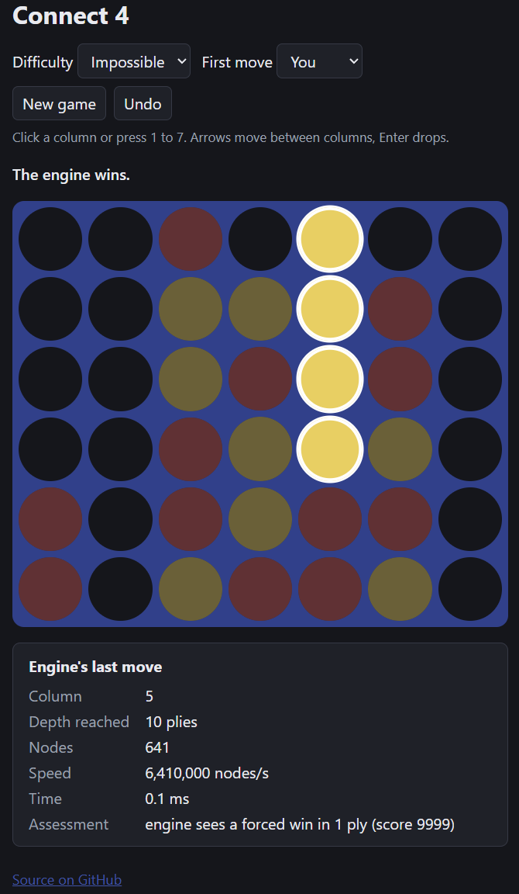
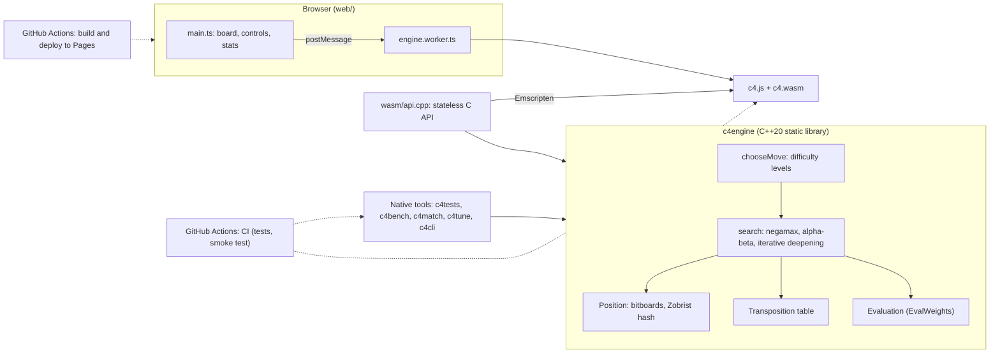

# connect-4-engine

[](https://github.com/RusteenSalehi/connect-4-engine/actions/workflows/ci.yml)
[](https://github.com/RusteenSalehi/connect-4-engine/actions/workflows/deploy.yml)

**[Live demo](https://rusteensalehi.github.io/connect-4-engine/)**: play against the engine in your
browser.

A Connect-4 engine in C++20 with negamax search, alpha-beta pruning, iterative deepening and a
Zobrist-keyed transposition table over a bitboard board. Four difficulty levels are built into the
engine, and a match tool shows each one beats the level below it. The same engine compiles to
WebAssembly and runs in a browser game on GitHub Pages, in a Web Worker so the page never
freezes. A benchmark reports nodes, nodes per second and time per move by depth, plus an
ablation table and a native vs WebAssembly comparison. Tests prove every combination of search
techniques returns the plain-minimax score. Details and reasoning: [DESIGN.md](DESIGN.md).



## Features

- **Engine**: bitboards with sentinel bits, negamax with fail-soft alpha-beta, iterative
  deepening with a time limit, a 2^20-entry transposition table keyed by Zobrist hashing (bound
  flags, mate-distance correction), TT-move-first and center-out move ordering, and a
  window-counting evaluation with all weights in one struct.
- **Difficulty levels** Easy, Medium, Hard and Impossible, chosen inside the engine from exact
  root-move scores, with seeded randomness.
- **Tools**: `c4bench` (benchmark), `c4match` (strength match between levels), `c4tune`
  (self-play weight tuning), `c4cli` (analyze a position or play in the terminal).
- **Browser game**: TypeScript and Vite, engine in a Web Worker, animated board, keyboard play,
  undo, win highlighting, live engine stats, light and dark mode, phone layout.
- **Tests and CI**: 43 doctest cases on every push (gcc on Ubuntu), a WebAssembly smoke
  test in Node, and automatic deployment to GitHub Pages.

## Architecture



## Engine design

- **Bitboards.** Two 64-bit words (side to move, all stones), 7 bits per column including an
  empty sentinel bit, so win detection is four shift-and-AND steps and playing a move is one
  addition. `Position` is 32 bytes and copied per child, so there is no undo code.
- **Negamax with alpha-beta.** One negamax function, fail-soft. An immediate win is detected
  before anything else, so wins are seen one ply past the depth limit and scored by distance
  (`10000 - ply`), which makes the engine win fast and lose slowly.
- **Iterative deepening.** Depth 1, 2, 3, ... until the depth limit, the time limit or a proven
  result. Each iteration leaves best moves in the TT that order the next one.
- **Transposition table.** 2^20 16-byte entries (16 MiB), always-replace, keyed by a 64-bit
  Zobrist hash that `play()` updates incrementally. Entries store bound flags (exact, lower,
  upper) and mate scores relative to the node, so a mate found at one ply stays correct at
  another.
- **Move ordering.** The TT's best move first, then columns from the center out. With ordering
  on, about 80% of beta cutoffs come from the first move tried.
- **Evaluation.** Counts open threes and twos over the board's 69 four-cell windows plus center
  stones. All three weights live in `EvalWeights`.
- **Tuning harness.** `c4tune` hill-climbs the weights by engine-vs-engine matches (49 two-ply
  openings, colors swapped, 98 games per match, a candidate must score above 55%), then validates
  at a depth it never tuned at. **Result: no change was accepted.** Every one-step neighbour of
  the default weights scored between 43.4% and 52.6% against them, so the defaults are a local
  optimum under this method. That is not proof they are globally best.

## Difficulty levels and strength

| Level | Search | Move choice |
|---|---|---|
| Easy | 1 ply | Random, weighted toward better moves (softmax). Always takes a win in one and blocks a loss in one. |
| Medium | 3 to 5 plies (random per move) | Random among moves within 3 points of the best. |
| Hard | 7 plies | A best move, random among ties. |
| Impossible | 10 plies, then deeper for up to 1 s | The best move, most central on ties. Stops early once the result is proven. |

**Strength match** (`c4match`): each pairing plays all 49 two-ply openings twice with colors
swapped (98 games), every move with a fixed seed and an empty TT. Results are from the stronger
level's point of view.

| Pairing | Games | Wins | Draws | Losses | Score | Minutes |
|---|---:|---:|---:|---:|---:|---:|
| Medium vs Easy | 98 | 87 | 2 | 9 | 89.8% | 0.0 |
| Hard vs Medium | 98 | 86 | 6 | 6 | 90.8% | 0.0 |
| Impossible vs Hard | 98 | 73 | 7 | 18 | 78.1% | 9.0 |

Each level scores 78% or more against the level below it, so the levels really are ordered by
strength. Impossible still loses 18 of 98 games to Hard: in 1 s it searches about 16 plies, not to
the end of the game, so it is not a perfect player. The first two pairings take seconds; Impossible
vs Hard took 9 minutes. Output: [bench/results/strength-match.md](bench/results/strength-match.md).
In a replay of this pairing (15 losses), an independent solver showed that 5 losses came from
openings already lost for Impossible, and 10 from a losing move at plies 2 to 8 that only a search
of 16 to 29 plies or deeper would have avoided, against the 14 to 20 plies Impossible reached in
its second.

## Benchmarks

`c4bench` searches 100 seeded random positions of 4 to 16 plies, one search per position, with
the TT cleared before each, so "time per move" is one search from a cold table.
Recorded 2026-10-21 on a Dell XPS 13 9345 (Snapdragon X Elite X1E80100), plugged in, WSL2
Ubuntu 26.04: native gcc 15.2 Release, and WebAssembly from Emscripten 6.0.12 (-O3) in Node
v24.22.0. Each build ran three times back to back; the tables show, verbatim, the run that was the
median at depth 12.

### Time per move by depth (native)

| Depth | Mean nodes | Mean ms | Median ms | Max ms | M nodes/s | TT hit rate | First-move cutoff rate |
|---:|---:|---:|---:|---:|---:|---:|---:|
| 2 | 26 | 0.005 | 0.005 | 0.013 | n/a | 12.4% | 87.0% |
| 4 | 213 | 0.024 | 0.025 | 0.079 | 9.01 | 36.1% | 82.6% |
| 6 | 1153 | 0.109 | 0.107 | 0.378 | 10.62 | 45.6% | 81.6% |
| 8 | 4897 | 0.421 | 0.363 | 1.778 | 11.64 | 50.9% | 81.6% |
| 10 | 17813 | 1.460 | 1.194 | 10.181 | 12.20 | 52.9% | 80.3% |
| 12 | 56312 | 4.568 | 2.939 | 41.966 | 12.33 | 54.7% | 79.1% |
| 14 | 167655 | 13.046 | 7.033 | 146.296 | 12.85 | 54.3% | 77.0% |
| 16 | 490270 | 38.539 | 13.067 | 577.647 | 12.72 | 52.2% | 73.9% |

**Stability:** the depth-12 mean over the three native runs was 4.688, 4.410 and 4.568 ms, a
6.3% spread (max over min), with identical node counts. The first native run's difficulty table
was an outlier (Hard 1.61 ms mean, against 0.42 and 0.43 ms in runs 2 and 3) and is not used.

### Difficulty levels (native)

| Level | Mean depth | Mean nodes | Mean ms | Median ms | Max ms | M nodes/s |
|---|---:|---:|---:|---:|---:|---:|
| Easy | 1.0 | 7 | 0.002 | 0.002 | 0.022 | n/a |
| Medium | 3.9 | 421 | 0.042 | 0.021 | 0.209 | 10.10 |
| Hard | 7.0 | 4936 | 0.426 | 0.360 | 2.275 | 11.58 |
| Impossible | 16.4 | 7482804 | 497.684 | 378.176 | 1001.114 | 15.04 |

### Ablation (native, one technique off at a time)

| Configuration | Depth | Mean nodes | Nodes vs all on | Mean ms | M nodes/s | TT hit rate | First-move cutoff rate |
|---|---:|---:|---:|---:|---:|---:|---:|
| All on | 10 | 17813 | 1.0x | 1.430 | 12.45 | 52.9% | 80.3% |
| No alpha-beta | 10 | 1967171 | 110.4x | 185.905 | 10.58 | 61.7% | n/a |
| No transposition table | 10 | 64754 | 3.6x | 4.654 | 13.91 | n/a | 70.5% |
| No move ordering | 10 | 235149 | 13.2x | 22.291 | 10.55 | 57.5% | 32.5% |
| No iterative deepening | 10 | 15768 | 0.9x | 1.221 | 12.92 | 26.0% | 65.0% |
| All on | 7 | 2483 | 1.0x | 0.226 | 10.98 | 49.6% | 82.6% |
| All off (pure minimax) | 7 | 276450 | 111.4x | 29.957 | 9.23 | n/a | n/a |

### Native vs WebAssembly

The same `bench/bench.cpp`, compiled by Emscripten and run in Node on the same machine right after
the native runs. Node counts are identical at every fixed depth, so the times compare the same
work. **WebAssembly was faster, not slower:** from depth 6 to 16 it took 0.78 to 0.87 times the
native time.
A wall-clock check agrees (whole `c4bench --depths 18` runs: 87.7 s native, 82.2 s WebAssembly, of
which about 50 s each is Impossible's fixed budget), and building native with `-mcpu=native` made it
only 4 to 6% faster. I have not investigated the cause; it holds for this ARM64 laptop, gcc 15.2 and
Node's V8, and may not elsewhere.

| Depth | Mean nodes (both) | Native mean ms | WASM mean ms | Native M nodes/s | WASM M nodes/s | WASM time / native |
|---:|---:|---:|---:|---:|---:|---:|
| 2 | 26 | 0.005 | 0.008 | n/a | n/a | 1.60x |
| 4 | 213 | 0.024 | 0.024 | 9.01 | 8.91 | 1.00x |
| 6 | 1153 | 0.109 | 0.095 | 10.62 | 12.14 | 0.87x |
| 8 | 4897 | 0.421 | 0.345 | 11.64 | 14.21 | 0.82x |
| 10 | 17813 | 1.460 | 1.179 | 12.20 | 15.11 | 0.81x |
| 12 | 56312 | 4.568 | 3.887 | 12.33 | 14.49 | 0.85x |
| 14 | 167655 | 13.046 | 10.591 | 12.85 | 15.83 | 0.81x |
| 16 | 490270 | 38.539 | 30.055 | 12.72 | 16.31 | 0.78x |

| Level | Native mean depth | WASM mean depth | Native mean nodes | WASM mean nodes | Native mean ms | WASM mean ms | Native M nodes/s | WASM M nodes/s |
|---|---:|---:|---:|---:|---:|---:|---:|---:|
| Easy | 1.0 | 1.0 | 7 | 7 | 0.002 | 0.005 | n/a | n/a |
| Medium | 3.9 | 3.9 | 421 | 421 | 0.042 | 0.033 | 10.10 | 12.83 |
| Hard | 7.0 | 7.0 | 4936 | 4936 | 0.426 | 0.342 | 11.58 | 14.44 |
| Impossible | 16.4 | 16.5 | 7482804 | 8577721 | 497.684 | 496.727 | 15.04 | 17.27 |

Impossible runs for a fixed 1 s, so its row compares how much it gets done: 8.58 M nodes and mean
depth 16.5 in WebAssembly vs 7.48 M nodes and depth 16.4 native. WebAssembly depth-12 times over
its three runs: 3.512, 3.887 and 4.050 ms (15.3% spread). Rows under a millisecond in total
show "n/a" for nodes per second, because the clock resolution dominates there.

Full outputs: [bench/results](bench/results).

## Testing

- **Minimax equivalence (differential).** On 60 seeded random positions at depths 1 to 6, all 16
  on/off combinations of alpha-beta, TT, move ordering and iterative deepening must return the
  plain-minimax score and a minimax-best move. Mutation testing confirmed it catches real TT
  bugs (a fail-low stored as exact, a lower bound accepted at alpha, ignoring stored depth).
- **Other differential tests**: bitboard win detection against a naive checker on 20,000 boards,
  the incremental Zobrist hash against a from-scratch hash over 200 games, and each level's root
  scores against plain minimax.
- **Mate distance through a reused TT**: after the best move, a proven result must be exactly
  one ply closer, which catches mate-score store and probe bugs the equivalence test misses.
- **Difficulty levels**: same seed gives the same move, Hard always plays a best move, Easy
  always takes and blocks wins in one, Impossible reaches depth 10.
- **Cross-compiler determinism**: the benchmark's node counts are identical under MSVC (Windows),
  gcc (Linux) and Emscripten (WebAssembly in Node). This is checked by comparing benchmark
  outputs, not by an automated test.
- **CI** builds and runs the tests on `ubuntu-latest` with gcc, and builds the WebAssembly module
  and runs its smoke test, on every push and pull request.

## Build and run

Requires CMake 3.21+, Ninja and a C++20 compiler.

**Native (Linux, gcc):**

```
cmake --preset linux-release
cmake --build --preset linux-release
build/linux-release/c4tests                 # tests
build/linux-release/c4bench                 # benchmark, about 2 minutes
build/linux-release/c4match                 # strength match, about 10 minutes
build/linux-release/c4cli play --difficulty hard
build/linux-release/c4cli analyze --moves 4453 --depth 12
```

On Windows use the `release` and `debug` presets from a "Developer PowerShell for VS 2022".

**WebAssembly** (Emscripten 6.0.12, pinned: `./emsdk install 6.0.12 && ./emsdk activate 6.0.12`,
then load `emsdk_env.sh`):

```
cmake --preset wasm
cmake --build --preset wasm
node web/scripts/smoke.mjs                  # smoke test of the web module
node build/wasm/c4bench.js                  # the benchmark, in WebAssembly
```

The web module exports `c4_choose_move(moves, difficulty, seed)`, the last search's stats,
`c4_win_score`, `c4_min_win_score` and `c4_winning_cells(moves)`; see `wasm/api.cpp`.

**Web** (Node 24; `npm run dev` and `npm run build` rebuild and copy the WebAssembly module first):

```
cd web
npm install
npm run dev        # http://localhost:5173/connect-4-engine/
npm run build      # type-checks and writes web/dist/
npm run preview    # http://localhost:4173/connect-4-engine/
```

After rebuilding the module, restart `npm run dev` (in WSL on a `/mnt/c` checkout Vite does not
see the copied files change).

## Project structure

```
engine/include/c4/, engine/src/   the engine library: position, zobrist, score, tt, eval,
                                  search, difficulty
tests/                            doctest tests
bench/bench.cpp, bench/results/   c4bench and recorded runs
match/match.cpp                   c4match (difficulty strength match)
analysis/                         loss analysis tools (solver, replay, probe), see DESIGN.md
tune/tune.cpp                     c4tune (evaluation tuning)
cli/cli.cpp                       c4cli (analyze, play)
wasm/api.cpp                      the WebAssembly API
web/                              browser game (index.html, src/*.ts, src/style.css)
web/scripts/smoke.mjs             Node smoke test for the WebAssembly module
.github/workflows/                CI and Pages deployment
```

## Design tradeoffs

- **Zobrist hash, not the perfect 64-bit key.** A Connect-4 position has an exact 64-bit
  encoding, but its low bits describe only the first columns, so it indexes a table badly.
  Zobrist bits are uniformly mixed, and the TT stores the full hash to reject slot collisions.
- **Always-replace TT.** Simplest policy; its cost is a shorter principal variation on deep
  searches, never a wrong move or score.
- **Copy-make instead of make-unmake.** A 32-byte copy per node removes all undo code.
- **Exact root scores for difficulty levels.** Each root move gets a full-window search, which
  costs more than one alpha-beta search but lets the levels tell a near-best move from a
  blunder.
- **Stateless WebAssembly API.** JavaScript passes the whole move string each call, so undo and
  new game need no engine state and the page cannot drift out of sync with the engine.
- **No killer moves or history heuristic.** About 80% of cutoffs already come from the first move
  tried, and nothing is optimized without a benchmark showing it matters.

## Future work

- Odd/even threat parity in the evaluation, the biggest known gap in Connect-4 play.
- Depth-preferred TT replacement, to keep the principal variation intact on deep searches.
- A wider tuning search (larger steps, three-ply openings) before claiming any weight change.
- An opening book or a solved-position database, so Impossible plays perfectly from the start.
- Solver-style pruning (never play below an opponent's threat) with threat-count move ordering.
